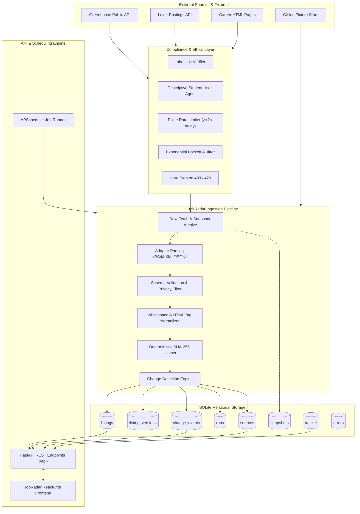

# JobRadar: Versioned Change-Tracking System for Internship & Job Listings

JobRadar is an ethical, deterministic, and compliance-first backend data pipeline and REST API designed to monitor student internship and early-career job boards. It tracks listings, detects field-level mutations (title, location, deadline changes), confirms removals, and logs complete version histories while guaranteeing zero false alerts on formatting-only updates.

The backend exposes a FastAPI REST API built to interface directly with the JobRadar React/Vite frontend.

---

## 1. Architecture Overview



---

## 2. Quickstart & One-Command Run

### Prerequisites
- Python 3.10+ (tested on Python 3.10 and 3.11+)
- Virtual environment tool (`venv`) or pip

### Installation
```bash
# Clone the repository
git clone <repo_url>
cd JobRadar

# Create and activate virtual environment
python -m venv venv
# On Windows:
.\venv\Scripts\activate
# On Linux/macOS:
source venv/bin/activate

# Install dependencies
pip install -r requirements.txt
# Alternatively using make:
make install
```

### One-Command Simulation & Verification
Demonstrate 3 complete refresh cycles (initial add, field mutations, confirmed removal):
```bash
make simulate
# Or using the CLI directly:
python -m jobradar simulate --source greenhouse_figma
```

### Run All Deterministic Offline Tests
```bash
make test
# Or using pytest directly:
pytest -v
```

### Start the FastAPI REST API Server
```bash
make serve
# Or:
python -m jobradar serve --host 0.0.0.0 --port 8000
```
Visit API Documentation: [http://localhost:8000/docs](http://localhost:8000/docs)

---

## 3. Compliance & Ethics Policy

JobRadar enforces ethical web scraping and strict compliance constraints:

1. **Robots Exclusion Standard (`robots.txt`)**:
   Before initiating crawling for any origin, `RobotsChecker` fetches and parses `robots.txt` via `urllib.robotparser`. If the target URL path is disallowed, the crawler immediately halts and logs a `RobotsDisallowedError`.
2. **Polite Request Throttling**:
   Every request enforces a polite delay (default $\ge 2.0$ seconds). No high-concurrency requests or aggressive burst scanning is permitted.
3. **Descriptive User-Agent**:
   Every HTTP request transmits a transparent User-Agent:
   `JobRadarBot/1.0 (student project; contact: student@university.edu)`
4. **Hard Stop on 403 (Forbidden) and 429 (Too Many Requests)**:
   If an origin responds with HTTP 429, the crawler halts immediately, parses `Retry-After`, and marks the source `rate_limited`. If HTTP 403 is received, the source is marked `blocked`. JobRadar **never** attempts to circumvent CAPTCHAs, Cloudflare Turnstile, login gates, or IP bans.
5. **Privacy & Data Minimization**:
   Recruiter personal contact information (email addresses and phone numbers) is automatically sanitized and redacted. Only public job attributes are retained. Raw descriptions are trimmed into short preview snippets (max 250 characters); full third-party web pages are never republished.
6. **Null Field Integrity**:
   JobRadar **never invents missing data**. If a job posting lacks a deadline or specific location, the field is explicitly stored as `NULL`.

---

## 4. Change Detection Logic & State Machine

The core change detection engine is strictly deterministic and idempotent:

- **Normalization**: All text fields have HTML markup stripped (`strip_html_tags`), leading/trailing whitespace trimmed, and internal consecutive whitespace collapsed.
- **Deterministic Content Hash**:
  $$content\_hash = \text{SHA256}(\text{JSON}(\{ \text{"company"}, \text{"deadline"}, \text{"job\_type"}, \text{"location"}, \text{"title"} \}))$$
  Formatting-only changes (HTML tag swapping, newline reformatting, tab indentation) result in an identical content hash and **zero false alerts**.
- **Change Categories**:
  - `added`: Entity ID unseen in historical database. Initiates version 1 and emits an `added` review event.
  - `edited`: Entity ID exists, but `content_hash` differs. Computes exact field-level diffs (`before_value`, `after_value`), appends a new `listing_versions` entry, and creates review items.
  - `unchanged/duplicate`: Entity ID exists and hash is identical. Updates `last_seen`, increments `duplicate_count`, resets `consecutive_misses=0`, and generates no review alerts.
  - `removed`: A listing missing from a single run is **not** immediately removed. If it is missing for $N$ consecutive successful runs (default $N=2$), its status transitions to `removed` and a confirmed removal event is emitted.
  - `restored`: If an entity was previously marked `removed` and reappears in a subsequent run, it is reactivated without creating duplicate `added` events.
  - `source_down`: If an HTTP 404, 5xx, or network timeout occurs, the source status becomes `unknown`/`stale`. No deletions and no removal counter increments occur.
  - `parser_failure`: If HTTP is 200 OK but 0 listings are extracted when listings previously existed, or $>50\%$ of items fail validation, a `parser_failure` alert is generated. **No listings are removed.**
- **Duplicate Event Suppression**:
  Identical tuples of `(entity_id, change_category, field, before_value, after_value)` in pending review state are suppressed to prevent review queue inflation.

---

## 5. Adding a New Source

All sources are configured in `config/sources.yaml`. To register a new job source:

1. Open `config/sources.yaml`.
2. Add an entry under `sources`:

```yaml
  - id: "greenhouse_newcompany"
    name: "New Company (Greenhouse)"
    type: "greenhouse"
    board_token: "newcompany"
    base_url: "https://boards-api.greenhouse.io/v1/boards/newcompany/jobs?content=true"
    refresh_interval_minutes: 60
    enabled: true
    mentor_approved: true
    filter_keywords:
      enabled: true
      keywords:
        - "intern"
        - "internship"
        - "student"
```

3. For HTML scraping sources, specify CSS selectors:
```yaml
  - id: "university_careers"
    name: "University Placement Page"
    type: "html"
    base_url: "https://example.edu/careers"
    refresh_interval_minutes: 180
    enabled: true
    mentor_approved: true
    selectors:
      item_list: "div.job-listing-item"
      title: "h3.job-title a"
      company: "span.company-name"
      location: "span.job-location"
      job_type: "span.job-type"
      link: "h3.job-title a"
      deadline: "span.application-deadline"
```

4. Verify that the URL returns 200 OK and check `robots.txt` compliance before enabling.

---

## 6. How CSS Selectors Work & Resilience

The `HtmlAdapter` uses BeautifulSoup4 backed by `lxml`:
1. `item_list`: Selects each card or row in the job list (e.g. `ol.list-recent-posts li`).
2. Inside each item container, individual selectors extract `title`, `company`, `location`, `job_type`, `link`, and `deadline`.
3. If a site layout changes and the `item_list` selector returns 0 elements on a previously populated board, the system flags a **`parser_failure`**, issues a diagnostic alert, logs the warning, and safely aborts without removing existing tracked listings.

---

## 7. Source Approval & Permission Notes Template

```markdown
### Source Verification & Mentor Approval Form
- **Source Identifier**: [e.g. greenhouse_figma]
- **Target URL / Endpoint**: [e.g. https://boards-api.greenhouse.io/v1/boards/figma/jobs]
- **Robots.txt Checked**: [YES / NO] (Robots URL: https://boards-api.greenhouse.io/robots.txt)
- **Robots Permission**: [ALLOWED]
- **Data Extracted**: Title, Company, Location, Canonical Link, Snippet
- **Rate Limit & Delay**: 2.0s minimum delay; max 10 requests per run
- **Mentor / Advisor Approval**:
  - Name: Dr. Academic Advisor
  - Status: APPROVED for educational change-tracking research
  - Date: 2026-11-19
```

---

## 8. Fallback & Failure Recovery Plan

1. **Origin Outage / 5xx / Timeout**:
   - The crawler attempts up to 3 retries with exponential backoff and randomized jitter ($1.5^a + \text{jitter}$).
   - If unsuccessful, the run records `status="failed"` and the source status changes to `"unknown"`. Existing listings remain intact.
2. **Rate Limiting (429) or Block (403)**:
   - Crawler stops immediately; honors `Retry-After`.
   - The source status is tagged `"rate_limited"` or `"blocked"`.
3. **HTML Redesign / Selector Breakage**:
   - `parser_failure` is detected when a populated page yields 0 records or $>50\%$ validation dropouts.
   - Run is tagged `"parser_failure"`, emitting a high-priority review item for the student to update selectors in `config/sources.yaml`.
4. **Stale Source Detection**:
   - Sources with `last_successful_at` older than $2 \times \text{refresh\_interval\_minutes}$ automatically trigger `is_stale: true` in `/api/summary`.

---

## 9. API Reference

All endpoints conform strictly to the JobRadar frontend specification under base path `/api`:

| Method | Path | Description |
|---|---|---|
| `GET` | `/api/summary` | Dashboard summary metrics, health status, and 7-day activity |
| `GET` | `/api/listings` | Filterable, sortable, paginated listings (`q`, `company`, `source`, `location`, `status`) |
| `GET` | `/api/listings/{entity_id}` | Detailed listing record including full version mutation history |
| `GET` | `/api/changes` | Review queue of detected changes (`category`, `review_status`, `page`) |
| `POST`| `/api/changes/{id}/review` | Verify or dismiss change review item (`action: "verify"` or `"dismiss"`) |
| `GET` | `/api/sources` | Status, metrics, warnings, and next run schedules for all sources |
| `GET` | `/api/runs` | Execution audit log with counts of added/updated/removed listings |
| `POST`| `/api/refresh` | Trigger manual crawl run (`source_id`, `mode: "live"` or `"fixture"`) |
| `GET` | `/api/tracker` | List all tracked student job applications and notes |
| `PUT` | `/api/tracker/{entity_id}` | Update application status (`interested`, `applied`, `interviewing`) and notes |
| `GET` | `/api/metrics` | Change detection verification metrics and false alert rate |
