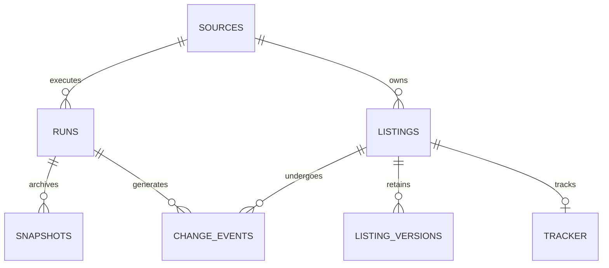

# JobRadar Data Dictionary & Schema Specification

This document provides the exhaustive specification for the SQLite relational data model, change-detection state machine, and data integrity guarantees implemented in **JobRadar**.

---

## 1. Relational Entity Diagram

---

## 2. Table Specifications

### 2.1 `sources`
Tracks configured crawl targets, source types, and operational health metrics.

| Column | Type | Nullable | Default | Description |
|---|---|---|---|---|
| `id` | `TEXT` | NO (PK) | - | Unique source identifier (e.g. `greenhouse_figma`, `lever_spotify`, `python_org_jobs`) |
| `name` | `TEXT` | NO | - | Human-readable company / platform name |
| `type` | `TEXT` | NO | - | Source adapter type (`greenhouse`, `lever`, `html`) |
| `base_url` | `TEXT` | NO | - | Canonical base URL or public API endpoint |
| `config_json` | `TEXT` | YES | `{}` | Serialized configuration (selectors, keywords, board token) |
| `status` | `TEXT` | NO | `'active'` | Operational status (`active`, `blocked`, `rate_limited`, `unknown`, `stale`, `failing`) |
| `last_attempted_at` | `DATETIME` | YES | NULL | Timestamp of latest run attempt (UTC) |
| `last_successful_at` | `DATETIME` | YES | NULL | Timestamp of latest successful crawl completion (UTC) |
| `last_http_status` | `INTEGER` | YES | NULL | Latest HTTP response code returned by origin |
| `parsed_count` | `INTEGER` | NO | `0` | Number of items parsed in latest successful crawl |
| `failed_count` | `INTEGER` | NO | `0` | Number of items failing schema validation in latest run |
| `duplicate_count` | `INTEGER` | NO | `0` | Number of unchanged listings detected in latest run |
| `warnings_json` | `TEXT` | NO | `'[]'` | JSON array of warnings generated during last run |
| `refresh_interval_minutes` | `INTEGER` | NO | `60` | Scheduled interval between automatic refreshes |
| `next_run_at` | `DATETIME` | YES | NULL | Scheduled UTC time of next automated crawl execution |

---

### 2.2 `runs`
Immutable audit log of every crawler execution for observability and reporting.

| Column | Type | Nullable | Default | Description |
|---|---|---|---|---|
| `run_id` | `TEXT` | NO (PK) | - | UUIDv4 string uniquely identifying the execution run |
| `source_id` | `TEXT` | NO (FK) | - | References `sources(id)` |
| `mode` | `TEXT` | NO | `'live'` | Execution mode: `'live'` or `'fixture'` |
| `status` | `TEXT` | NO | - | Run outcome (`success`, `partial_failure`, `failed`, `blocked`, `rate_limited`, `parser_failure`) |
| `started_at` | `DATETIME` | NO | `now()` | Execution start timestamp (UTC) |
| `finished_at` | `DATETIME` | YES | NULL | Execution termination timestamp (UTC) |
| `source_url` | `TEXT` | NO | - | Target URL fetched during this run |
| `http_status` | `INTEGER` | YES | NULL | HTTP response status code |
| `parsed_count` | `INTEGER` | NO | `0` | Count of successfully parsed listing records |
| `failed_count` | `INTEGER` | NO | `0` | Count of records dropped due to schema validation failure |
| `new_count` | `INTEGER` | NO | `0` | Count of newly added listing entities |
| `updated_count` | `INTEGER` | NO | `0` | Count of edited listings detected |
| `removed_count` | `INTEGER` | NO | `0` | Count of listings transitioned to removed status |
| `duplicate_count` | `INTEGER` | NO | `0` | Count of duplicate/unchanged listings re-observed |
| `warnings_json` | `TEXT` | NO | `'[]'` | JSON array of warning messages logged |
| `error_message` | `TEXT` | YES | NULL | Detailed error description if run failed |

---

### 2.3 `snapshots`
Raw payload archives ensuring auditability and reproducible fixture replays.

| Column | Type | Nullable | Default | Description |
|---|---|---|---|---|
| `id` | `INTEGER` | NO (PK AUTO) | - | Auto-increment primary key |
| `run_id` | `TEXT` | NO (FK) | - | References `runs(run_id)` |
| `source_id` | `TEXT` | NO (FK) | - | References `sources(id)` |
| `raw_payload_path` | `TEXT` | NO | - | Filesystem path where raw payload file is preserved |
| `sha256` | `TEXT` | NO | - | Cryptographic SHA-256 hash of unparsed payload body |
| `http_status` | `INTEGER` | NO | - | HTTP response code received when snapshot was captured |
| `fetched_at` | `DATETIME` | NO | `now()` | Exact timestamp when snapshot was fetched (UTC) |

---

### 2.4 `listings`
Core listing entity containing canonical current state and lifecycle counters.

| Column | Type | Nullable | Default | Description |
|---|---|---|---|---|
| `entity_id` | `TEXT` | NO (PK) | - | Stable identifier: `{source_id}:{native_id}` or SHA-256 of `canonical_url` |
| `source_id` | `TEXT` | NO (FK) | - | References `sources(id)` |
| `title` | `TEXT` | NO | - | Cleaned job position title |
| `company` | `TEXT` | NO | - | Company or employer organization name |
| `location` | `TEXT` | YES | NULL | Geographical office or remote designation (NULL if absent) |
| `job_type` | `TEXT` | YES | NULL | Employment commitment (e.g. `Internship`, `Full-time`) |
| `deadline` | `TEXT` | YES | NULL | Application deadline (never invented: NULL if unprovided) |
| `canonical_url` | `TEXT` | NO | - | Direct canonical URL to the posting |
| `source_url` | `TEXT` | NO | - | Source board or API URL where item was discovered |
| `detected_at` | `DATETIME` | NO | `now()` | Timestamp of first detection or latest transition |
| `source_updated_at`| `DATETIME` | YES | NULL | Upstream timestamp from source payload (if available) |
| `first_seen` | `DATETIME` | NO | `now()` | Timestamp when entity was first discovered |
| `last_seen` | `DATETIME` | NO | `now()` | Timestamp of the most recent run where listing was present |
| `content_hash` | `TEXT` | NO | - | Deterministic SHA-256 hash of normalized core fields |
| `status` | `TEXT` | NO | `'active'` | Lifecycle status (`active`, `removed`, `unknown`) |
| `last_change_category`| `TEXT` | YES | NULL | Most recent change category (`added`, `edited`, `unchanged`, `removed`, `restored`) |
| `consecutive_misses` | `INTEGER` | NO | `0` | Number of consecutive successful runs where entity was absent |

---

### 2.5 `listing_versions`
Append-only historical archive of listing mutations over time.

| Column | Type | Nullable | Default | Description |
|---|---|---|---|---|
| `id` | `INTEGER` | NO (PK AUTO) | - | Primary key |
| `entity_id` | `TEXT` | NO (FK) | - | References `listings(entity_id)` |
| `version_no` | `INTEGER` | NO | - | Sequential version number (`1, 2, 3...`) |
| `run_id` | `TEXT` | NO (FK) | - | References `runs(run_id)` |
| `detected_at` | `DATETIME` | NO | `now()` | Timestamp when this version was detected |
| `content_hash` | `TEXT` | NO | - | SHA-256 hash of fields at this version snapshot |
| `title` | `TEXT` | NO | - | Title snapshot |
| `company` | `TEXT` | NO | - | Company snapshot |
| `location` | `TEXT` | YES | NULL | Location snapshot |
| `job_type` | `TEXT` | YES | NULL | Job type snapshot |
| `deadline` | `TEXT` | YES | NULL | Deadline snapshot |
| `fields_json` | `TEXT` | NO | `'{}'` | Complete JSON dictionary of normalized fields |

> **Constraint**: Unique constraint on `(entity_id, version_no)`.

---

### 2.6 `change_events`
Individual field-level mutation events reviewed by the user.

| Column | Type | Nullable | Default | Description |
|---|---|---|---|---|
| `id` | `INTEGER` | NO (PK AUTO) | - | Primary key |
| `entity_id` | `TEXT` | NO (FK) | - | References `listings(entity_id)` |
| `listing_title` | `TEXT` | NO | - | Title of listing at time of event |
| `company` | `TEXT` | NO | - | Company name |
| `change_category` | `TEXT` | NO | - | Event type (`added`, `edited`, `removed`, `restored`, `parser_failure`) |
| `field` | `TEXT` | YES | NULL | Specific field changed (`title`, `location`, `deadline`, `status`) |
| `before_value` | `TEXT` | YES | NULL | Historical field value before mutation |
| `after_value` | `TEXT` | YES | NULL | Current field value after mutation |
| `run_id` | `TEXT` | NO (FK) | - | References `runs(run_id)` |
| `detected_at` | `DATETIME` | NO | `now()` | Detection timestamp (UTC) |
| `review_status` | `TEXT` | NO | `'pending'` | Review stage (`pending`, `verified`, `dismissed`) |
| `source_url` | `TEXT` | YES | NULL | Canonical source posting URL |

> **Index**: `ix_change_events_suppression` on `(entity_id, change_category, field, review_status)`.

---

### 2.7 `errors`
Structured error catalog logging all network, parsing, and compliance blocks.

| Column | Type | Nullable | Default | Description |
|---|---|---|---|---|
| `id` | `INTEGER` | NO (PK AUTO) | - | Primary key |
| `run_id` | `TEXT` | YES (FK) | NULL | References `runs(run_id)` (if run was initiated) |
| `source_id` | `TEXT` | YES (FK) | NULL | References `sources(id)` |
| `error_type` | `TEXT` | NO | - | Category (`http_error`, `timeout`, `parser_failure`, `robots_disallowed`, `rate_limited`, `blocked`) |
| `message` | `TEXT` | NO | - | Human-readable explanation of the error |
| `details_json` | `TEXT` | YES | NULL | Supplementary diagnostic JSON metadata |
| `occurred_at` | `DATETIME` | NO | `now()` | Error occurrence timestamp (UTC) |

---

### 2.8 `tracker`
Student application stage and interview notes linked to a specific job listing.

| Column | Type | Nullable | Default | Description |
|---|---|---|---|---|
| `entity_id` | `TEXT` | NO (PK, FK) | - | References `listings(entity_id)` |
| `status` | `TEXT` | NO | `'interested'` | Application status (`interested`, `applied`, `interviewing`, `offer`, `rejected`, `archived`) |
| `notes` | `TEXT` | YES | NULL | Markdown student preparation notes or feedback |
| `updated_at` | `DATETIME` | NO | `now()` | Timestamp of last user modification (UTC) |

---

## 3. Change Detection & Idempotency Rules

### 3.1 Normalization & Deterministic Content Hash
To ensure that formatting-only differences (HTML tag changes, indentation, whitespace variations) never trigger false change alerts:
1. All string fields undergo HTML tag removal (`strip_html_tags`), collapsing of consecutive internal whitespace, and leading/trailing trimming.
2. Canonical key order is strictly enforced: `{"company": ..., "deadline": ..., "job_type": ..., "location": ..., "title": ...}`.
3. Values are lowercased for deterministic content comparison.
4. `content_hash = sha256(json.dumps(canonical, sort_keys=True))`.

### 3.2 State Transitions & Consecutive Misses
- **Addition (`added`)**: Entity ID not previously present in `listings`. Created with `status='active'`, `version_no=1`, and an initial `change_events` entry.
- **Modification (`edited`)**: Existing entity ID with differing `content_hash`. Field-level diff identifies exact attributes (`title`, `location`, `deadline`). Increments version counter, appends a row to `listing_versions`, and updates `last_seen`.
- **Duplicate (`unchanged`)**: Existing entity ID with identical `content_hash`. Updates `last_seen`, resets `consecutive_misses=0`, increments run `duplicate_count`, creates **no change event**.
- **Confirmed Removal (`removed`)**: If an active listing is absent from a successful run, its `consecutive_misses` counter increments by 1. Only when `consecutive_misses >= N` (configurable, default 2) is the listing marked `'removed'` and an alert emitted.
- **Restoration (`restored`)**: If a previously removed entity reappears in a subsequent run, its status is restored to `'active'`, `consecutive_misses` is reset to 0, and a restoration alert is created. **Duplicate "added" events are never created.**
- **Transient Source Failure (`source_down`)**: If a source returns 404, 5xx, or network timeout, the source state is marked `'unknown'`, and **no listings are marked removed**.
- **Parser Failure**: If response is HTTP 200 but yields 0 results when active jobs were previously tracked, or CSS selectors fail, `change_events(parser_failure)` is recorded; **no listings are marked removed**.
